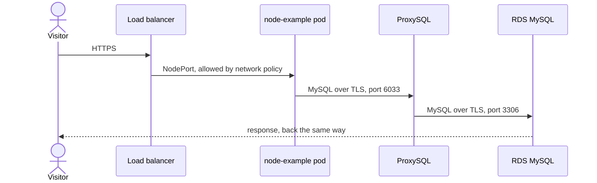

# Private EKS platform on AWS

A small but complete platform, built entirely with Terraform: a Kubernetes cluster nobody can reach from the internet, a load balancer that serves an app anyway, a MySQL database you can restore without restarting anything, and environments that differ only in the settings they choose to change.

## The idea

Most of this project follows from one decision: **the Kubernetes API is private.** That raises three questions, and the answers shape the rest.

- **How do people get in?** Through an SSM tunnel to a small bastion, with no inbound ports and no SSH keys. They assume an IAM role, and that role decides what they can do in the cluster. Nobody is added to the cluster directly.
- **How does automation get in?** Through a CodeBuild project inside the VPC. GitHub Actions asks it to run the Kubernetes steps, so the hosted runners never need network access.
- **How does traffic get in?** Through a public load balancer that forwards to the nodes. Inside the cluster, network policies accept only that traffic, so other pods cannot reach the app.

The same care goes into the database. Apps talk to ProxySQL rather than to MySQL itself, so a restore can build a new instance next to the live one and switch over while the apps keep their connections.

## What you get

- **Private cluster:** EKS with a private API endpoint, managed nodes and Pod Security enforced.
- **Controlled access:** per-environment admin and viewer roles, and a command that [cuts access immediately](docs/ACCESS.md#revoke-access).
- **The app and its AWS resources:** `swordhealth/node-example`, a read-only bucket, a write-only bucket, an SQS queue with a dead-letter queue, and listing pods in `kube-system` through the Kubernetes API.
- **MySQL with a tested way back:** RDS with point-in-time recovery and daily AWS Backup, and a [side-by-side restore](docs/DATABASE.md#restore-side-by-side) in one command.
- **Reusable environments:** a shared base config, plus an [overlay](docs/CONVENTIONS.md#configuration-layers) that holds only what each environment changes.
- **Optional CI/CD:** GitHub Actions with OIDC and no stored AWS keys, planning on every pull request and applying through a manual workflow, with [approvals where your GitHub plan offers them](docs/DEPLOYMENT.md#configure-approvals).
- **End-to-end checks:** `make verify` proves the isolation and permissions from inside the cluster, including what must be denied.

## The pieces

| Component | What it does |
|---|---|
| **VPC** | Public, private and database subnets across three zones, with a NAT Gateway for outbound traffic |
| **EKS cluster** | Runs the workloads on managed nodes. Its API is reachable only from inside the VPC |
| **Bastion** | A tiny instance with no inbound rules, used only as the far end of the SSM tunnel |
| **IAM roles** | Admin and viewer for people, plan and apply for CI. Kept apart from everything they give access to |
| **Application Load Balancer** | The only public entry point. Sends HTTPS traffic to the nodes |
| **node-example** | The app. Isolated from other pods, with AWS access scoped to exactly what it needs |
| **ProxySQL** | Sits between the app and MySQL, and can switch database at runtime |
| **RDS MySQL** | The database, with automated backups, reachable only from the nodes |
| **CodeBuild runner** | Optional. Runs the Kubernetes steps of CI from inside the VPC |

[Architecture](docs/ARCHITECTURE.md) shows how they work together, with a sequence diagram for each flow.

A request from the internet takes this path:



## Quick start

You need an AWS account and credentials. `make init` checks the tools and what your credentials are allowed to do.

```bash
make init                   # check tools and AWS credentials (read-only)
make state  ENV=dev         # create the Terraform state bucket, once per environment
make access ENV=dev         # create the IAM roles
make up-all ENV=dev         # create everything else, about 30 minutes
```

Then reach the private cluster and run the checks:

```bash
make tunnel ENV=dev         # terminal 1: keep it running

make kubeconfig ENV=dev     # terminal 2: once per cluster
export KUBECONFIG=.kube/dev.kubeconfig
kubectl get pods -A
make verify ENV=dev
```

`make help` lists every command. When you are done, `make down-all ENV=dev` removes everything except the state bucket and roles.

## Guides

| I want to | Read |
|---|---|
| Understand how it works and why | [Architecture](docs/ARCHITECTURE.md) |
| Deploy it, locally or with GitHub Actions | [Deployment](docs/DEPLOYMENT.md) |
| Create a new environment | [Environments](docs/ENVIRONMENTS.md) |
| Give someone access, or take it away | [Access](docs/ACCESS.md) |
| Restore the database | [Database](docs/DATABASE.md) |
| Learn what a stack is, and how things are named | [Conventions](docs/CONVENTIONS.md) |
| See what should change for production | [Production](docs/PRODUCTION.md) |
| Make a change, and see what this repository leaves out, such as releases | [Contributing](CONTRIBUTING.md) |

## Repository layout

```
Makefile              the entry point: make help
bootstrap/            run-once roots: state bucket, GitHub OIDC provider
stacks/               the stacks, one Terraform state each
modules/              reusable building blocks used by the stacks
envs/base/            configuration every environment shares
envs/overlays/<env>/  what one environment changes
envs/examples/prod/   a hardened example to copy, not deployed
scripts/              what make runs; scripts/py/ holds the larger Python commands
.github/workflows/    ci.yml, apply.yml, db-restore.yml
docs/                 the guides above
```

Built with Terraform `>= 1.11` and the AWS provider `~> 6.0`, in `us-east-1` by default.
