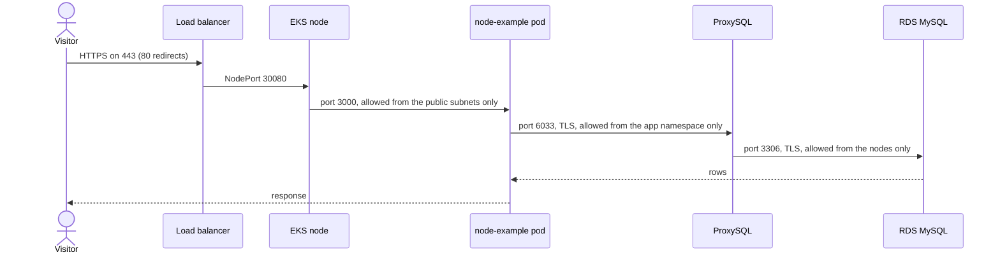
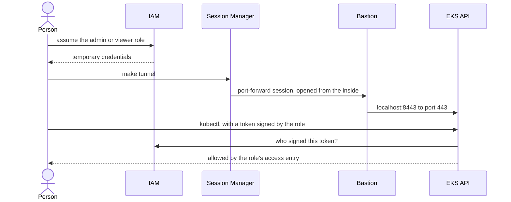
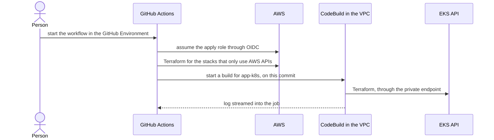

# Architecture

How the parts fit together, and why they were chosen. For names and terms such as *stack* and *overlay*, see [Conventions](CONVENTIONS.md).

- [Components](#components)
- [How it works](#how-it-works)
- [How it is checked](#how-it-is-checked)
- [Key decisions](#key-decisions)

## Components

### Network

- **VPC:** public, private and database subnets across three availability zones.
- **NAT Gateway:** outbound internet for the private subnets, because nodes pull images from Docker Hub. Dev shares one; prod has one per zone.
- **S3 gateway endpoint:** S3 traffic skips the NAT.

Database subnets have no route to the internet.

### Cluster

- **EKS control plane:** the API endpoint is private. Network policies are enforced by the VPC CNI.
- **Managed node group:** Spot instances in dev, on-demand in prod, at a fixed size.
- **Bastion:** a `t4g.nano` with no public IP, no SSH and no inbound rules. It exists only as the far end of the SSM tunnel.

### Identity

- **People:** `<project>-<env>-admin` and `<project>-<env>-viewer`. See [Access](ACCESS.md).
- **CI:** `<project>-<env>-github-plan` (read-only) and `<project>-<env>-github-apply`. See [Deployment](DEPLOYMENT.md#with-github-actions).
- **Services:** the nodes, bastion, AWS Backup, CodeBuild and each workload have their own roles, kept with the resource that uses them.

### Application

- **node-example:** two replicas of `swordhealth/node-example:0.0.1` on port 3000, with a PodDisruptionBudget and the restricted Pod Security Standard.
- **Its AWS access, through EKS Pod Identity:**
  - Read bucket: list and get only.
  - Write bucket: put only.
  - SQS queue with a dead-letter queue: receive, delete, change visibility and get attributes.
  - Its own database secret, and not the master secret.
- **Its Kubernetes access:** a `Role` and `RoleBinding` that let its ServiceAccount list pods in `kube-system`, and nothing else.
- **Isolation:** the namespace denies all ingress by default and allows only the public subnets, where the load balancer lives. `externalTrafficPolicy: Local` keeps the source IP, which is what makes that rule work.

### Traffic

- **Application Load Balancer:** a target group of type `instance` on a fixed NodePort, attached to the node group's Auto Scaling group, so nodes join and leave automatically.
- **Certificate:** self-signed by default, because there is no domain. Port 80 redirects to 443. See [HTTPS](DEPLOYMENT.md#https).

### Data

- **RDS MySQL 8.4:** Multi-AZ in prod, reachable only from the node security group, with TLS required.
- **ProxySQL:** the app's only route to MySQL. See [why it is here](DATABASE.md#why-proxysql).
- **Database users:** the app and ProxySQL monitor each have their own user and secret. A Kubernetes Job in its own namespace keeps those users in sync with their secrets. No password appears in Terraform state or in Kubernetes objects.
- **Backups:** RDS automated backups and a daily AWS Backup plan. See [Database](DATABASE.md).

### Automation

- **GitHub Actions:** `ci.yml` plans every pull request, `apply.yml` applies when started by hand, and `db-restore.yml` runs a restore. Both run in a GitHub Environment, which can [require approval](DEPLOYMENT.md#configure-approvals).
- **CodeBuild runner:** optional. Runs the steps that need the private Kubernetes API from inside the VPC.

## How it works

### Serving a request

### Reaching the private cluster

Two separate questions are answered along the way: IAM decides who may open the path, and the EKS access entry decides what they can do once through.

The kubeconfig points at `https://localhost:8443` but still verifies the real EKS certificate through `tls-server-name`.

### Applying a change from CI

The hosted runner has no route to the private API, so the one stack that needs it runs inside the VPC.

### Restoring the database

See the diagram in [Restore side by side](DATABASE.md#restore-side-by-side).

## How it is checked

`make verify ENV=<env>` needs the tunnel. It starts short-lived debug pods under the app's ServiceAccount and checks both what must work and what must be denied:

1. **Private API:** the endpoint is private, and it does not answer from outside the tunnel.
2. **App permissions:**
   - Read bucket: list and get are allowed, put is denied.
   - Write bucket: put is allowed, list and get are denied.
   - Queue: receive and delete are allowed, send is denied.
   - Secrets: its own database secret is allowed, the master secret is denied.
3. **RBAC:** listing pods in `kube-system` returns 200, and in `default` returns 403.
4. **Isolation:** pods in `default` and in the app's own namespace cannot reach the app. A control check proves their network works. A pod in `default` cannot reach ProxySQL.
5. **MySQL through ProxySQL:** TLS works on both legs and plaintext is rejected. The connection is the app user, which cannot create another database. Every ProxySQL pod sees its backend `ONLINE`.
6. **Load balancer:** targets are healthy, HTTP redirects to HTTPS, the certificate verifies, and `GET /users` reaches the app's own route.

## Key decisions

### Structure

| Topic | Chosen | Instead of | Why |
|---|---|---|---|
| State | One S3 bucket per env, native locking, one state per stack | One shared bucket, Terraform Cloud, DynamoDB locks | An env's state and permissions stay isolated: the dev CI role cannot touch prod state |
| Layout | Separate stacks along real boundaries: who applies them, which network path they need, how long they live | One large root | A small change plans only its own stack. A mistake in one cannot destroy another. No Kubernetes provider configured from resources in the same apply |
| Stack order | Plain names, with the order in one list in `scripts/lib.sh` | Numbered directories | Numbers break when a stack is inserted, and they hide rules |
| Environments | Plain Terraform, layered tfvars and a Makefile | Terragrunt, workspaces | No extra tooling, and a file shows exactly how an env differs |
| Bootstrap | Throwaway state, with resources found afterwards by tag or URL | A bootstrap stack with local state | Nothing local to lose or share, and nothing in the repo can destroy state by accident |

### Access

| Topic | Chosen | Instead of | Why |
|---|---|---|---|
| API access | Private endpoint, SSM port-forward through a bastion | Client VPN, public endpoint with an allowlist, SSH bastion | Meets "not public", with no inbound ports or keys, and every session is IAM-audited |
| Tunnel target | A small instance | EC2 Instance Connect Endpoint, SSM VPC endpoints, a worker node | The Instance Connect Endpoint allows only ports 22 and 3389, and SSM needs an instance as its target. Using a node would lose access exactly when nodes are unhealthy |
| Cluster auth | EKS access entries, by role | `aws-auth` ConfigMap, IAM users, creator as admin | Managed as AWS resources, granted and revoked in one place, with no implicit admin |
| Pod to AWS | EKS Pod Identity | IRSA | Less boilerplate, and the trust policy does not depend on the cluster's OIDC URL |

### Workloads and data

| Topic | Chosen | Instead of | Why |
|---|---|---|---|
| Load balancer | Terraform-managed ALB to a fixed NodePort | AWS Load Balancer Controller with Ingress | Literally "a load balancer to the nodes", with no controller, and never orphaned on destroy |
| Network policy | VPC CNI native policies | Calico | Nothing extra to install |
| Nodes | Managed node group, fixed size | Karpenter, Cluster Autoscaler, Fargate | Nothing here generates load to scale on. Fargate does not fit a load balancer to nodes |
| MySQL | RDS | MySQL on EC2 or in the cluster | Backups, point-in-time recovery, patching and encryption come built in |
| DB credentials | Dedicated users, with secrets in Secrets Manager, synced by a Job | The app on the master secret, the `mysql` Terraform provider | Least privilege, the secret's ARN survives restores, and Terraform needs no network path to the database |
| DB access | ProxySQL | Direct connection, RDS Proxy | See [Why ProxySQL](DATABASE.md#why-proxysql) |

### Automation

| Topic | Chosen | Instead of | Why |
|---|---|---|---|
| CI auth | GitHub Actions with OIDC | Stored keys, Terraform Cloud, Atlantis | No long-lived credentials |
| CI config | Role and region derived from the repo | Repository variables | Nothing to set up in GitHub beyond Environments |
| CI to the private API | A CodeBuild build in the VPC | A tunnel from the hosted runner, a self-hosted runner | One job, so a required approval is asked for once. No dependency on the bastion, and nothing listens to GitHub |
