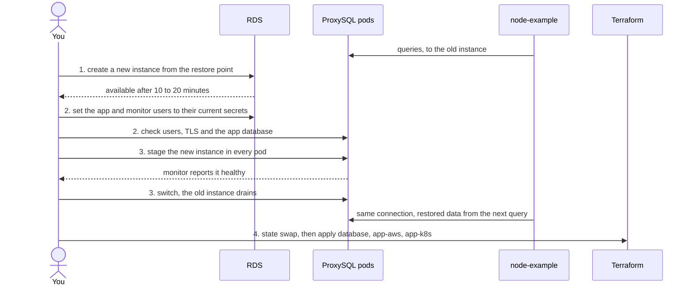

# Database

RDS MySQL 8.4 behind ProxySQL, with automated backups and two ways back, depending on whether the instance is still there.

- [Which restore do I need?](#which-restore-do-i-need)
- [Restore side by side](#restore-side-by-side)
- [Restore after an outage](#restore-after-an-outage)
- [Backups](#backups)
- [Why ProxySQL](#why-proxysql)
- [Users and passwords](#users-and-passwords)

## Which restore do I need?

Start with what happened, and with whether the instance still exists:

| | Side by side | After an outage |
|---|---|---|
| **When** | Bad data, a wrong migration: the instance is alive | The instance is gone: deleted, or after `down-all` |
| **Command** | `make db-restore ARGS='restore <point>'` | `TF_VAR_restore_snapshot_id=<id> make up-all` |
| **Apps during it** | Keep running on the old data until the switch | Have no database until it is back |
| **Restarts** | None | None for the app, though the database is unavailable |
| **The way back** | `rollback`, while the old instance exists | Restore from another point |
| **Time** | About 15-30 minutes, with the app serving throughout | As long as creating the instance, with no database meanwhile |
| **What is lost** | Writes after the restore point, which you choose | Writes after the snapshot or restore point |

To see what you can restore from, in either case:

```bash
make db-restore ENV=dev ARGS=list
```

This shows live instances, point-in-time windows, snapshots and AWS Backup recovery points, and it changes nothing.

## Restore side by side

**This is the usual case.** The live database keeps serving while its replacement is built next to it, and nothing changes for the app until you switch.

```bash
make db-restore ENV=dev ARGS='restore latest'                 # or a UTC time, or a snapshot id or ARN
make db-restore ENV=dev ARGS='restore 2026-01-31T12:00:00Z'
```



1. **Create:** `<project>-<env>-mysql-<26 hex>` appears next to the live instance, with the same settings. Nothing else changes.
2. **Check:** the app and monitor users on the new instance are set to their current secrets, so a backup older than those works. From a ProxySQL pod, they then log in over verified TLS, and the app database exists.
3. **Cutover:** in every pod, the new instance waits until the monitor reports it healthy. Every pod goes first, so a failure switches nothing. It then replaces the old one, which drains. The switch is saved in the pods and the backend ConfigMap.
4. **Finalize:** Terraform takes over the new instance through a state swap, stopping if a plan would replace it. There is nothing to commit.

**Decide the restore point carefully:** writes made to the old instance after that point are not in the new one.

**Passwords always follow the current secrets.** Only the instance being switched to changes: backups, secrets and the live instance are left as they are. A `rollback` does the same for the instance it returns to.

**It is safe to re-run.** The same command continues where it stopped, for example after a dropped tunnel.

### Look before you switch

```bash
make db-restore ENV=dev ARGS='restore latest --stop-before-cutover'
DB_ID=<new id> scripts/db-sql.sh dev "SHOW TABLES FROM app"               # your own check
make db-restore ENV=dev ARGS='restore latest'                             # continues, and switches
```

### Afterwards

The old instance keeps running, so you can still go back:

```bash
make db-restore ENV=dev ARGS='rollback <old id>'     # switch back, while it exists
make db-restore ENV=dev ARGS='retire <old id>'       # delete it, keeping a final snapshot
```

A rollback leaves behind any writes made to the new instance since the switch.

### Before `down-all`

**NOTE: Retire every instance a restore or rollback left behind before running `down-all`.**

Each `restore` leaves the old instance running, and each `rollback` leaves the one it switched away from. Terraform destroys only the instance it manages, and it doesn't know about the others.

To find them, run `list`. Every instance except the one marked as managed by Terraform needs retiring:

```bash
make db-restore ENV=dev ARGS=list
make db-restore ENV=dev ARGS='retire <id>'     # for each of them; waits until it is deleted
```

Otherwise `down-all` stops halfway, at the `database` stack, after the cluster and apps are already gone:

```
Error: deleting ENIs using Security Group (sg-...): detaching RDS ENI (eni-...): ...
  api error AuthFailure: You do not have permission to access the specified resource.
Error: deleting RDS DB Parameter Group (<project>-<env>-mysql-...): ...
  InvalidDBParameterGroupState: One or more database instances are still members of this parameter group ...
```

Both errors mean an instance still uses the database's security group and parameter group. The fix is the same: retire it, and run `down-all` again, which continues where it stopped.

**Snapshots stay, and cost money until deleted.** `down-all` doesn't remove them, and nothing else does either. These are kept:

- The final snapshot of each retired instance (`<id>-final-<time>`).
- The final snapshot `down-all` takes (`<project>-<env>-mysql-final-<suffix>`). Keep it if you want the data back.
- Any snapshot you took by hand, for example for testing.

Once you no longer need one, delete it:

```bash
aws rds delete-db-snapshot --db-snapshot-identifier <id>
```

### How the Kubernetes steps run

Setting the users, check and cutover go through the SSM tunnel. One that is already open is reused. Otherwise the command opens one after the RDS waits and closes it at the end.

From GitHub, `db-restore.yml` runs the same command as one job, with those steps as CodeBuild builds. `K8S_VIA=codebuild` does the same locally. See [Tunnel or CodeBuild](DEPLOYMENT.md#tunnel-or-codebuild).

## Restore after an outage

When no instance exists, there is nothing to stand next to, and nothing to copy settings from, so `restore` refuses. Terraform creates the instance from a backup instead.

The value is passed once as an environment variable. It only matters at creation, so there is nothing to commit or undo.

**The whole environment is down** (`down-all` prints this command with its final snapshot):

```bash
TF_VAR_restore_snapshot_id=<id> make up-all ENV=dev
```

**Or from a point in time,** using a retained automated backup's resource ID from `list`:

```bash
TF_VAR_restore_point_in_time='{source_dbi_resource_id="db-ABC123",restore_time="2026-01-31T12:00:00Z"}' \
  make up-all ENV=dev
```

**Only the instance was lost,** and the rest of the environment is up:

```bash
TF_VAR_restore_snapshot_id=<id> make up STACK=database ENV=dev
ONLY=app-aws make up-all ENV=dev      # the new master secret
ONLY=app-k8s make up-all ENV=dev      # re-syncs users against the new instance
kubectl -n proxysql rollout restart deploy/proxysql
```

The restart is needed because running ProxySQL pods keep the address they started with, and the instance's address has changed. Until then the app still points at the lost instance.

The MySQL users come back with the data, and the user Job resets them to their current secrets.

**Afterwards,** the next plan of `database` shows a new suffix for the final snapshot's name, as the variable is no longer set. Applying it changes nothing else on the instance.

## Backups

| | Dev | Prod |
|---|---|---|
| RDS automated backups, with point-in-time recovery | 7 days | 14 days |
| AWS Backup, daily | 7 days | 35 days |

Destroying keeps the data: `make down` takes a final snapshot and keeps the automated backups until they expire. Multi-AZ is on in prod.

## Why ProxySQL

The app connects to `proxysql.proxysql.svc:6033`, and ProxySQL holds the real database address. Having that one layer in between is what makes the restore above possible.

| | Without ProxySQL | With ProxySQL |
|---|---|---|
| **Restore to a new instance** | Change `DB_HOST`, apply, restart every app | Switch at runtime, with no restart and no config change |
| **App connections during a switch** | Dropped | Kept; the next query goes to the new instance |
| **Backend reboot or failover** | Every app sees broken connections and has to reconnect | Apps stay connected to ProxySQL; only a transaction in flight fails |
| **Checking a new database first** | Only by pointing something at it | It waits unused until the monitor reports it healthy, and an unhealthy one is refused |
| **Going back** | Another config change and restart | `rollback`, the same runtime switch |
| **Connection count on the database** | One per app connection | Pooled, and capped per pod by `backend_max_connections` |

**What it costs:**

- One more thing to run and patch, in the path of every query.
- With a single replica (dev), a node drain or Spot interruption briefly cuts database connections. Prod runs two, with a PDB.

**How it is secured:**

- TLS on both legs, verified against the RDS CA bundle.
- Only the app's namespace can connect, on port 6033.
- No password in Kubernetes or on a node's disk: an init container renders the config from Secrets Manager into memory-backed storage.
- The admin interface listens on `127.0.0.1` inside each pod, with a random password per pod. Reaching it takes `kubectl exec`, which RBAC controls.

**Alternatives:** Amazon RDS Proxy is the managed option. See [Production](PRODUCTION.md).

## Users and passwords

| User | Used by | Can do |
|---|---|---|
| Master | Admins and the user Job | Everything. The password is managed and rotated by RDS |
| `app` (`db_users.app`) | The apps, through ProxySQL | Work on `db_name` only, TLS required |
| `proxysql_monitor` (`db_users.monitor`) | ProxySQL's health checks | `USAGE` only |

The app reads its password from the secret in `DB_SECRET_ARN`. That secret's ARN doesn't depend on the instance, so a restore leaves the app's config unchanged.

**To rotate a password:** bump `db_users.<app|monitor>.password_version` in `envs/overlays/<env>/database.tfvars`, and apply `database` and `app-k8s`. A new Job resets the user. ProxySQL picks up the new password when it restarts:

```bash
kubectl -n proxysql rollout restart deploy/proxysql
```

**To run SQL by hand** as master, from a short-lived pod, because the database only accepts the nodes:

```bash
scripts/db-sql.sh dev "SHOW DATABASES"
```
